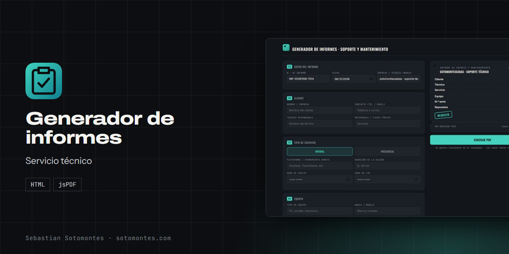
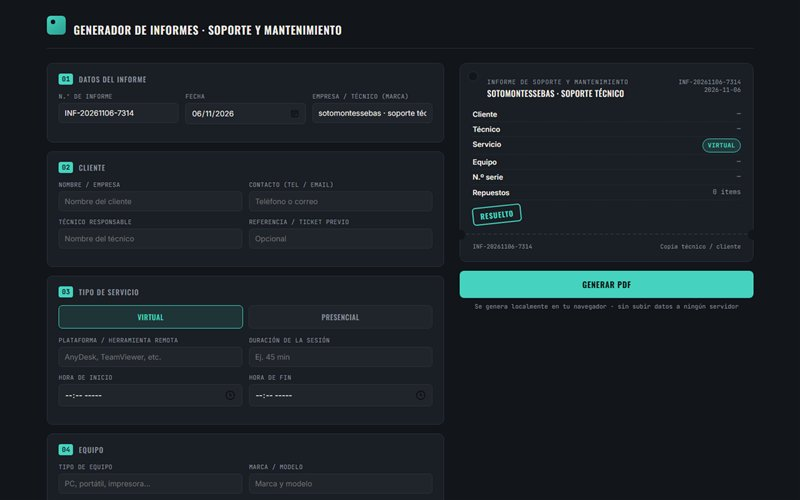
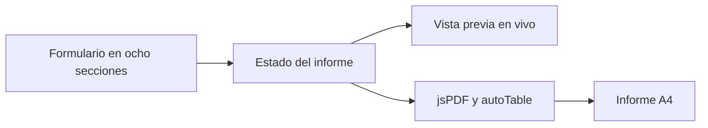

Informes de reparación y soporte, virtuales o presenciales, con vista previa en vivo y PDF profesional.

<a href="https://sotomontes.com/#generador-de-informes"><b>Ver en sotomontes.com</b></a> · <a href="#cómo-se-usa">Cómo se usa</a> · <a href="#cómo-funciona-por-dentro">Cómo funciona</a> · <a href="#novedades">Novedades</a>

| Ficha técnica | |
|---|---|
| **Autor** | Sebastian Sotomontes |
| **Tipo** | Servicio técnico |
| **Plataforma** | Navegador web, sin instalación |
| **Versión** | 1.0 |
| **Estado** | Estable |
| **Stack** | HTML · jsPDF |
| **Código** | Privado. Esta página es solo una presentación. |

---

## Qué es

Herramienta para documentar servicios de reparación, soporte y mantenimiento, sea virtual o presencial. Mientras llenas el formulario ves el ticket armándose en vivo, y al final obtienes un informe profesional en PDF A4.

## Novedades

- Vista previa en vivo y PDF numerado por secciones.

## Cómo se usa

1. Abre la herramienta. El número de informe y la fecha ya vienen listos.
2. Llena los datos del cliente y del técnico.
3. Elige **Virtual** o **Presencial**: los campos cambian según el tipo.
4. Describe el equipo, el diagnóstico y el trabajo realizado.
5. Agrega repuestos y materiales, y marca el estado.
6. Pulsa **Generar PDF**.

## Funciones

- **ID de informe** autogenerado.
- **Servicio virtual o presencial** con campos según el modo.
- **Datos** de cliente, técnico y equipo.
- **Diagnóstico** y trabajo realizado.
- **Tabla dinámica** de repuestos y materiales.
- **Conformidad y firma**.

## Detalles

- El PDF sale numerado por secciones, con insignia de estado y pie paginado.
- Diseño con la metáfora de una orden de trabajo física.

## Privacidad y seguridad

El PDF se genera en tu navegador, sin subir datos a ningún servidor.

## Cómo funciona por dentro

### Arquitectura

### Cómo funciona

Una sola página mantiene el estado del formulario y lo refleja en el ticket de vista previa. Al exportar, jsPDF dibuja el documento y autoTable arma la tabla de repuestos, con paginación automática.

**Créditos:** usa jsPDF.

---

© 2026 Sebastian Sotomontes. Todos los derechos reservados.
